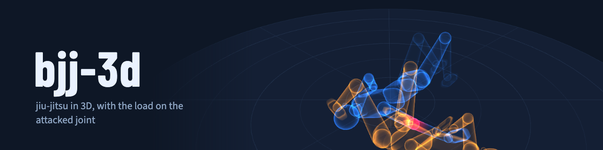

# bjj-3d

Brazilian jiu-jitsu positions and transitions in 3D. Two jointed mannequins play each
transition; in a submission, the attacked joint lights up as the lock tightens and a note
says when it can cause injury.

It covers the whole [GrappleMap](https://github.com/Eelis/GrappleMap) database: 601 positions
and 1,485 transitions, no-gi, linked into a graph you can walk ("from here you can…").

## What you see

- **Mannequins**: a rigid, rounded piece between each pair of GrappleMap joints, a ball at
  each joint, blocks for the torso, a plain head (a small nose shows where it faces), simple
  hands and feet, and a belt. Nothing deforms: every piece is placed straight from the 23
  joints per player, so the figure is exactly the data. Amber and blue stay the same people
  while you chain transitions.
- **Contact**: GrappleMap's figures are thin; given thickness they would sink into each other.
  An offline solver (`web/src/contact.ts`) gives each player capsules as thick as the
  mannequin's pieces, separates what overlaps (touching is allowed), keeps bone lengths, keeps
  everything above the mat and stays close to the original pose. It also adds an in-between
  frame per keyframe gap so limbs do not pass through each other on the way. Over the
  database, the deepest overlap per transition goes from 5.2 cm to 1.5 cm (median; 1 cm is
  allowed).
- **Looks**: *solid* (the fighter's colour, easiest to read), *wood* (an artist's mannequin
  with joints in the fighter's colour) and *x-ray* (translucent, to see limbs hidden behind
  the other body).
- **Joint load**: one reading per submission kind, lit on the attacked joint only.

  | kind | reading | danger from |
  |---|---|---|
  | elbow lock | elbow flexion, with the opponent's hips on the elbow | under 14° |
  | knee bar | knee flexion, with the opponent's hips on the knee | under 25° |
  | shoulder lock (kimura, omoplata) | internal rotation of the upper arm | over 110° |
  | knee twist (heel hook, toe hold) | rotation of the shin under the bent knee | over 60° |
  | choke | gap between the throat and the axis of the opponent's second-closest limb | under 12.2 cm |
  | neck crank | neck flexion | over 75° |

  These are angles and distances, not forces: GrappleMap has neither forces nor timing.
  [docs/validation.md](docs/validation.md) checks them against every finish in the database
  (15 of 20 reach the danger range; the other five never get there in the animation).
- **Interface**: the panel shows what is on screen, the moves you can make next (they
  continue from where the current one ends) and three ways in: techniques explained step by
  step, finishes, and positions. Settings float over the view: look, place, camera (free,
  side, above, a fighter's eyes), speed, and options (repeat, other side, show one fighter,
  joint angle). A short "how to use" shows on the first visit.
- **Fighters**: each one can be customized on a screen of its own, standing alone: build
  (slim to sturdy) and belt (white, blue, purple, brown, black). The contact solver is tuned
  to the standard build, so a much sturdier one may overlap a little more.
- **Places**: a competition mat (1 m tiles, 8 × 8 m area with a safety border), a gym (the
  mat in a room with padded walls), a plain studio (an endless backdrop where only shadows
  show depth) and the dark grid. All are drawn in code; nothing is downloaded.
- **Theme**: light or dark, following the system on the first visit.
- **Reviewed techniques**: a transition can carry hand-written names (English and Portuguese),
  steps and notes from `data/techniques/`. Their text stays marked as a draft until reviewed.

## Languages

16 languages, as in [mathra](https://github.com/matheusmota-dev-br/mathra): `pt-BR` (default),
`en`, `es`, `fr`, `de`, `it`, `ru`, `zh`, `ja`, `ko`, `hi`, `ar` (right to left), `id`, `tr`,
`nl` and `pl`, chosen at the top of the panel. Each one is a JSON file in `web/src/locales/`
with the keys of `en.json`. Portuguese and English are reviewed; the other languages still
need a native speaker's review. Position and transition names stay in English, as in
GrappleMap, and technique texts exist in English and Portuguese only.

## Running

```
cd web
npm install
npm run dev
```

`npm run build` writes a static site to `web/dist`. Links: `#p/<n>` opens position *n*,
`#t/<n>` transition *n* (`#t/<n>r` backwards), and `?frame=<k>` opens paused at keyframe *k*.
For checking: `?debug=1` draws the solved stick figures over the mannequins, and
`?graph=<file>` loads another build of the data.

## Layout

```
data/grapplemap/       GrappleMap database, unchanged (public domain)
data/techniques/       reviewed techniques: one JSON file per transition
data/body/capsules.json  thickness of each body part (metres), shared by the mannequin and
                       the contact solver
tools/                 icon.svg, banner.html and brand.mjs, which renders docs/banner.png
                       and the PNG icons from the running viewer
web/src/
  grapplemap.ts        reader; matches poses up to rotation, mirror and player swap
  contact.ts           offline contact solver and in-between frames
  landmarks.ts         a player's joints as vectors
  mannequin.ts         the jointed mannequin, placed from the joints every frame
  metrics.ts           joint readings per submission kind
  materials.ts         the looks (solid, wood, x-ray), with the load glow
  environment.ts       the places: mat, gym, studio, night
  i18n.ts, locales/    interface text, one JSON file per language
  viewer.ts            scene, playback, chaining, cameras
  data.ts, main.ts     graph, search and the page
web/scripts/
  build-data.ts        GrappleMap + data/techniques -> solved poses -> web/public/graph.json
  validate.ts          writes docs/validation.md
  calibrate.ts         raw distributions used to pick thresholds
  find.ts              search transitions from the command line
```

## Adding a reviewed technique

```json
{
  "id": "armlock-from-knee-on-belly",
  "reviewed": false,
  "names": { "en": "Armbar from knee on belly", "pt-BR": "Chave de braço do joelho na barriga" },
  "source": { "grapplemap_line": 14237, "from": "knee on belly vs underhook", "to": "arm bar w/ single leg over" },
  "steps": [{ "frame": 0, "text": { "en": "…", "pt-BR": "…" } }]
}
```

`grapplemap_line` is where the transition starts in `GrappleMap.txt`; `npm run find -- "<name>"`
lists candidates. The build checks that the line goes from `from` to `to`. Optional fields:
`note` and `risk` (both `{en, pt-BR}`).

## Tests

```
cd web
npm test           # reader, position matching, contact solver, joint readings
npm run validate   # regenerates docs/validation.md
```

## Sources and license

Motion: [GrappleMap](https://github.com/Eelis/GrappleMap) by Eelis van der Weegen and
contributors, public domain. The thickness of the body parts was measured once on a body
generated with [MPFB2](https://static.makehumancommunity.org/mpfb.html) (CC0 assets).

Code under MIT or Apache-2.0, at your option.
